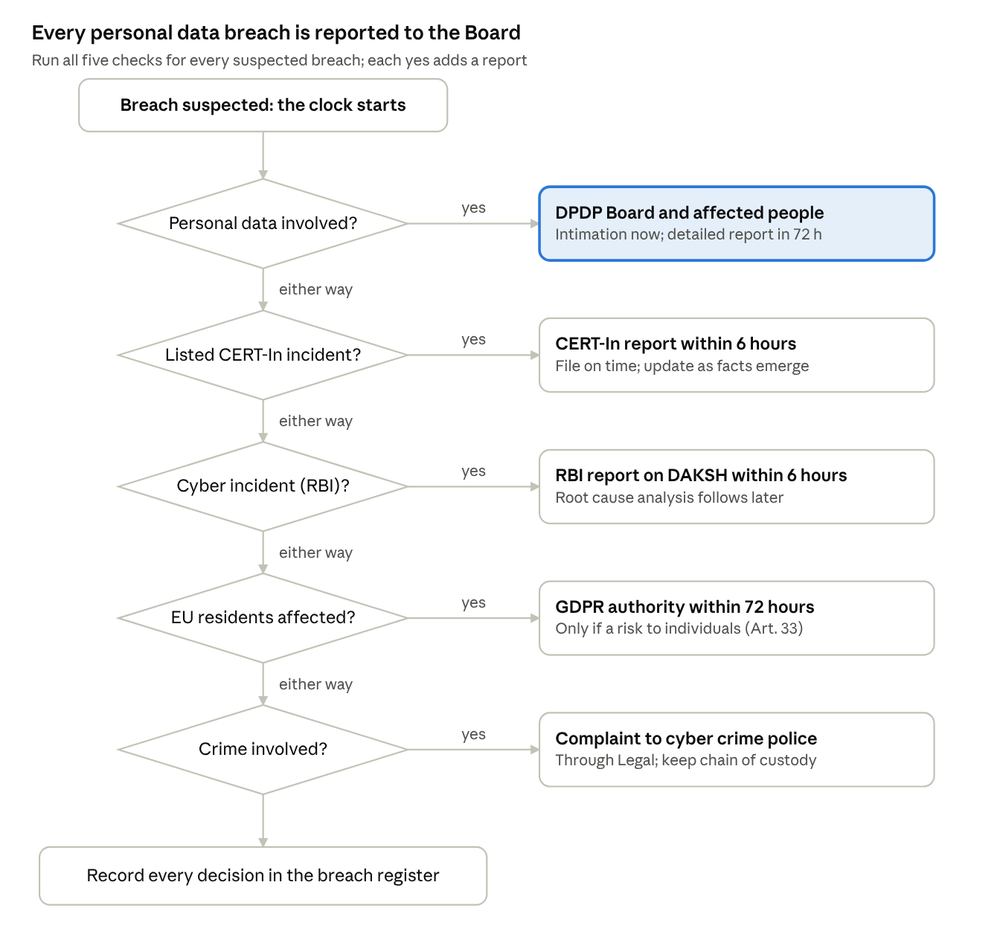

# Personal Data Breach Response Playbook & Tabletop Kit

*Suvidha Finserv Ltd (fictional NBFC) · Portfolio project · Khooshi Joshi · November 2026*

## Contents

1. [Purpose, scope and how to use this playbook](#1-purpose-scope-and-how-to-use-this-playbook)
2. [Company profile](#2-company-profile-suvidha-finserv-ltd-fictional)
3. [Regulatory obligations and parallel timelines](#3-regulatory-obligations-and-parallel-timelines)
4. [Breach Response Team and RACI](#4-breach-response-team-and-raci)
5. [Breach classification and severity matrix](#5-breach-classification-and-severity-matrix)
6. [Response workflow: hour by hour](#6-response-workflow-hour-by-hour)
7. [Reportability decision tree](#7-reportability-decision-tree)
8. [Notification templates](#8-notification-templates)
9. [Evidence handling and breach register](#9-evidence-handling-and-breach-register)
10. [Tabletop exercise kit](#10-tabletop-exercise-kit-the-open-bucket)
11. [Post-incident review, metrics and KPIs](#11-post-incident-review-metrics-and-kpis)
12. [Control mapping](#12-control-mapping)
13. [Assumptions and disclaimer](#13-assumptions-and-disclaimer)

---

## 1. Purpose, scope and how to use this playbook

This playbook tells Suvidha Finserv's Breach Response Team exactly what to do, who decides, and which regulator to notify by when, from the first hour of a suspected personal data breach to closure.

**Purpose**

- Contain personal data breaches fast and limit harm to customers.
- Meet every reporting deadline: CERT-In (6 hours), the Data Protection Board (initial intimation without delay, detailed report within 72 hours) and RBI.
- Produce an evidence trail that holds up to regulators, auditors and courts.

**Scope**

- All personal data processed by Suvidha Finserv in digital form, in-house or through processors (cloud, KYC vendors, collection agencies, call centres).
- All breach types: cyber attacks, misconfigurations, misdirected emails, lost devices, insider misuse and vendor-side breaches.
- Out of scope: security incidents with no personal data involved. These follow the general Incident Response Plan, but the CERT-In timeline in Section 3 still applies.

**How to use it**

1. The first person to suspect a breach reports it to the Breach Response Lead (Section 4). The clock starts at that moment.
2. The Lead classifies severity (Section 5) and runs the reportability decision tree (Section 7) within the first hour.
3. The team follows the response workflow (Section 6) and uses the ready templates (Section 8).
4. Every action is logged in the breach register (Section 9).
5. The tabletop kit (Section 10) is run at least once a year to test this playbook.

**Document control**

| Item | Detail |
| --- | --- |
| Owner | Data Protection Officer |
| Approved by | Board Risk Management Committee |
| Version | 1.0 |
| Review cycle | Annual, and after every Severity 1 or 2 breach |
| Related documents | Information Security Policy, Incident Response Plan, Business Continuity Plan, Vendor Risk Management Policy |

## 2. Company profile: Suvidha Finserv Ltd (fictional)

Suvidha Finserv is a fictional RBI-registered NBFC in Ahmedabad that holds KYC and financial data on about 12 lakh customers, so a breach here touches DPDP, CERT-In and RBI at once.

| Attribute | Detail |
| --- | --- |
| Business | Digital personal loans and gold loans through a mobile app and 40 branches in Gujarat |
| Customers | About 12 lakh active borrowers |
| Employees | About 900, plus collection agents and call-centre vendors |
| Regulators | RBI (NBFC), CERT-In, Data Protection Board of India |
| DPDP status | Data Fiduciary, assumed to be notified as a Significant Data Fiduciary because of volume and sensitivity of data |
| Cloud | Core lending and app hosted on a public cloud (Mumbai region) |

**Personal data held**

| Data category | Examples | Where it lives |
| --- | --- | --- |
| Identity and KYC | Name, PAN, Aadhaar (masked), photo, address proof | KYC platform, cloud object storage |
| Financial | Bank account, salary slips, bank statements, credit score | Loan management system |
| Contact | Mobile number, email, address | CRM, app database |
| Device and app data | Device ID, location at onboarding, app logs | App backend, analytics |
| Employee data | HR records, payroll | HRMS (SaaS) |

**Key processors (Data Processors under DPDP)**

- Cloud provider (hosting and storage)
- eKYC and video-KYC vendor
- Credit bureau integration partner
- Call-centre and collection agencies
- Email and SMS gateway

Every processor contract requires the vendor to notify Suvidha within **2 hours** of discovering a breach affecting Suvidha data, so Suvidha can meet its own 6-hour CERT-In deadline.

## 3. Regulatory obligations and parallel timelines

A single cyber breach of customer data can start three regulatory clocks at once: CERT-In and RBI at 6 hours, and the Data Protection Board at 72 hours, so all three run in parallel from the moment Suvidha becomes aware.

| Regulator | What triggers it | Deadline | What to send | Channel |
| --- | --- | --- | --- | --- |
| CERT-In | Any of the listed cyber incident types (e.g., data breach, data leak, ransomware, unauthorised access) | Within 6 hours of noticing or being told | Initial report in the CERT-In format; update as facts emerge; logs on request | CERT-In portal or email |
| RBI | Cyber incident affecting the NBFC | Within 6 hours of detection | Incident report; root cause analysis later | RBI DAKSH portal |
| Data Protection Board | Any personal data breach, no risk threshold | Initial intimation without delay; detailed report within 72 hours of becoming aware | Nature, extent, timing, location, likely impact; then cause, mitigation, person responsible, and proof of notices to individuals | Board's online platform |
| Affected Data Principals | Any personal data breach | Without delay | Plain-language notice: what happened, likely consequences, mitigation taken, safety steps, contact point | SMS, email, in-app |
| Law enforcement | Criminal activity (extortion, theft, fraud) | As soon as practical | Complaint with evidence | Cyber crime cell / cybercrime.gov.in |
| GDPR supervisory authority | Only if EU residents' data is affected | 72 hours, if a risk to individuals | Article 33 notification | Lead authority |

**Rules the team must remember**

- **Awareness starts the clock.** It is when any employee or processor reasonably suspects a breach, not when the investigation confirms it.
- **Report with incomplete facts.** File an initial report on time and update it. A late, complete report is worse than an on-time partial one.
- **Every personal data breach is reportable under DPDP.** There is no materiality threshold, so minor cases are reported too.
- **Logs must exist to be shared.** CERT-In requires ICT logs to be kept for a rolling 180 days in India, with clocks synced to NIC or NPL time servers.

**Penalty exposure under the DPDP Act**

| Failure | Maximum penalty |
| --- | --- |
| Failing to take reasonable security safeguards to prevent a breach | ₹250 crore |
| Failing to notify the Board or affected individuals of a breach | ₹200 crore |

*Note: DPDP Rules were notified on 13 November 2025 and commence in phases. This playbook applies Rule 7 now so the team is ready before it takes full effect.*

Sources: [DPDP Rule 7 summary](https://www.mondaq.com/india/privacy-protection/1707558/digital-personal-data-protection-rules-2025-highlights) · [DPDP penalties](https://treelife.in/tag/dpdp) · [CERT-In Directions](https://www.tcsa.in/frameworks/iso-27001/for-cert-in) · [RBI NBFC cyber directions 2026](https://taxguru.in/?p=1065479)

## 4. Breach Response Team and RACI

The DPO leads every personal data breach, the CISO leads the technical response, and only the CEO can approve external statements or a ransom decision.

**Core team**

| Role | Held by | Main job in a breach |
| --- | --- | --- |
| Breach Response Lead | Data Protection Officer (DPO) | Owns the breach end to end, decides reportability, signs off DPDP notices |
| Technical Response Lead | CISO | Containment, investigation, evidence, CERT-In technical details |
| Legal Counsel | Head of Legal | Legal privilege, regulator and law-enforcement liaison, contract claims against vendors |
| Compliance Officer | Chief Compliance Officer | RBI reporting, regulatory correspondence |
| Communications Lead | Head of Corporate Communications | Customer notices, media statements, call-centre scripts |
| Business Owner | Head of the affected business line | Impact on customers and operations, business decisions |
| Executive Sponsor | CEO | Final approval on public statements, major spending, ransom decision |
| Vendor Manager | Head of Procurement / TPRM | Gets facts and evidence from affected processors |

**RACI for key decisions** (R = Responsible, A = Accountable, C = Consulted, I = Informed)

| Activity | DPO | CISO | Legal | Compliance | Comms | CEO |
| --- | --- | --- | --- | --- | --- | --- |
| Classify severity | A | R | C | C | I | I |
| Contain and investigate | I | A/R | C | I | I | I |
| Decide reportability | A/R | C | C | C | I | I |
| CERT-In report (6h) | C | A/R | C | I | I | I |
| RBI report (6h) | C | C | C | A/R | I | I |
| DPDP Board intimation and 72h report | A/R | C | C | C | I | I |
| Notify affected customers | A | C | C | I | R | I |
| Media statement | C | I | C | I | R | A |
| Ransom or extortion decision | C | C | R | C | I | A |
| Post-incident review | A/R | R | C | C | I | I |

**Escalation and contacts**

- Each role has a named primary and a named deputy, so the 6-hour deadline is met at night and on holidays.
- The contact sheet (phone, personal email, deputy) is kept offline as well, in case email or the network is down.
- External contacts kept on the sheet: retained IR firm, cyber insurer, outside counsel, CERT-In, RBI, and the cloud provider's security team.

## 5. Breach classification and severity matrix

Severity is set within the first hour by business and customer harm, not by technical complexity, and it decides who is woken up and how fast.

**Breach types**

| Type | Meaning | Example at Suvidha |
| --- | --- | --- |
| Confidentiality | Data seen or taken by someone not authorised | KYC files exposed in a public storage bucket |
| Integrity | Data changed without authorisation | Attacker alters customers' bank account numbers for disbursal |
| Availability | Data lost or locked | Ransomware encrypts the loan management system |

**Severity matrix**

| Severity | Typical triggers | Who is engaged | Response target |
| --- | --- | --- | --- |
| Sev 1, Critical | More than 10,000 customers, or any KYC, Aadhaar or bank data at scale; ransomware on core systems; attacker still active; media or social-media exposure | Full team plus CEO, retained IR firm, insurer | Team assembled within 30 minutes |
| Sev 2, High | 1,000 to 10,000 customers, or financial data of fewer customers; compromised privileged account | Full core team | Within 1 hour |
| Sev 3, Medium | Under 1,000 customers with limited data (e.g., names and phone numbers); contained malware with possible data access | DPO, CISO, Legal | Same business day |
| Sev 4, Low | Single-customer misdirected email or letter; lost encrypted device | DPO and the business owner | Within 2 business days |

**Factors that raise severity by one level**

- Children's data or data of vulnerable customers is involved.
- Data was clearly exfiltrated, not just exposed.
- A processor caused it and cannot yet give full facts.
- The data enables fraud directly (KYC documents, bank details, OTP or login credentials).

**Remember:** severity sets the speed and the people involved. It does **not** decide whether to report. Under DPDP, even a Sev 4 breach is reported to the Board and to the affected person.

## 6. Response workflow: hour by hour

The first 6 hours decide whether Suvidha meets its CERT-In and RBI deadlines, so containment, classification and the initial reports all run in parallel inside that window.

| Time from awareness (T) | Action | Owner |
| --- | --- | --- |
| T+0 | Suspected breach reported to the DPO and CISO; breach register entry opened with the exact awareness time | Whoever spots it |
| T+0 to 30 min | Contain: isolate affected systems (disconnect, do not power off), revoke exposed links and keys, disable compromised accounts | CISO |
| T+0 to 30 min | Preserve evidence: logs, snapshots, memory captures, emails; start chain of custody | CISO |
| T+1 h | Severity classified (Section 5); team assembled; reportability tree run (Section 7) | DPO |
| T+1 h | Processor involved? Vendor Manager demands facts and evidence under the contract's 2-hour clause | Vendor Manager |
| T+2 to 4 h | Scope the breach: data categories, number of customers, exfiltrated or only exposed, attacker still present | CISO, DPO |
| T+4 h | Draft CERT-In and RBI reports; Legal reviews | CISO, Compliance, Legal |
| **By T+6 h** | **CERT-In report filed; RBI report filed on DAKSH** | CISO, Compliance |
| Without delay (target T+6 to 12 h) | Initial intimation to the Data Protection Board | DPO |
| Without delay (target T+24 h) | Notices to affected customers; call-centre script and FAQ ready; fraud monitoring raised | Comms, DPO |
| T+24 to 48 h | Eradicate the cause; recover from clean backups; reset credentials; watch for re-entry | CISO |
| **By T+72 h** | **Detailed report to the Data Protection Board**, with proof of customer notices | DPO |
| T+72 h onward | Update CERT-In and RBI as facts change; insurer claim; law enforcement complaint where relevant | CISO, Compliance, Legal |
| Within 21 days | Root cause analysis and RBI follow-up | CISO, Compliance |
| Within 30 days | Post-incident review, corrective action plan, playbook update (Section 11) | DPO |

**Do not**

- Delete or rebuild systems before evidence is captured.
- Contact the attacker or discuss payment without Legal and the CEO.
- Make public statements before Comms and Legal approve them.
- Wait for a complete picture before filing the 6-hour reports.

## 7. Reportability decision tree

Run all five checks within the first hour of every suspected breach: each yes adds a report, and any breach of personal data always goes to the Board and the affected people.



If no personal data is involved, the event follows the general Incident Response Plan, but the CERT-In and RBI checks still apply. Record each answer, with the time and who decided, in the breach register.

## 8. Notification templates

These four templates are pre-approved by Legal, so on the day the team only fills the brackets and gets sign-off from the role named in the RACI.

**8.1 CERT-In initial report (by T+6 h)**

```
Subject: Cyber incident report - Suvidha Finserv Ltd - [Incident ID]

Organisation: Suvidha Finserv Ltd (RBI-registered NBFC), Ahmedabad
Point of contact: [Name, designation, phone, email]
Incident type: [e.g., Data breach / Data leak / Unauthorised access]
Time of occurrence (if known): [DD-MM-YYYY HH:MM IST]
Time noticed: [DD-MM-YYYY HH:MM IST]
Affected systems: [System names, IPs, cloud resources]
Brief description: [What happened, as known so far]
Indicators of compromise: [IPs, domains, file hashes, accounts]
Actions taken so far: [Containment steps]
Status: Investigation ongoing. Further details will be shared as available.
```

**8.2 Data Protection Board: initial intimation (without delay)**

```
To: Data Protection Board of India
Data Fiduciary: Suvidha Finserv Ltd
DPO contact: [Name, email, phone]

Nature of breach: [Confidentiality / integrity / availability]
Description: [What happened]
Extent: [Approx. number of Data Principals, data categories]
Timing: [When it occurred, when we became aware]
Location: [System / processor / region]
Likely impact on Data Principals: [e.g., risk of identity misuse or financial fraud]
```

**8.3 Data Protection Board: detailed report (within 72 h)**

```
1. Updated description of the breach, timeline and extent
2. Facts and circumstances that led to the breach (root cause)
3. Measures taken to mitigate risk and contain the breach
4. Findings on the person or entity that caused the breach
5. Remedial steps to prevent recurrence
6. Report on notices sent to affected Data Principals
   (date sent, channel, number notified, copy of notice attached)
```

**8.4 Customer notice (without delay)**

```
Subject: Important: a security incident involving your Suvidha Finserv account

Dear [Customer name],

On [date], we found that [plain description, e.g., some of your KYC
documents were exposed through a storage error]. The information involved
was: [list].

What this could mean for you: [e.g., someone could try to misuse your
identity documents].

What we have done: [secured the system, informed authorities, added
fraud monitoring on your account].

What you can do:
- Be careful of calls or messages asking for OTPs or passwords.
  Suvidha will never ask for them.
- Check your credit report and bank statements.
- Report anything suspicious to us at once.

Contact: [Grievance Officer / DPO], [phone], [email].
We are sorry this happened.
```

**Sign-off before sending:** CERT-In (CISO + Legal), RBI (Compliance + Legal), Board (DPO + Legal), customers (DPO + Comms + Legal).

## 9. Evidence handling and breach register

Every breach, reported or not, gets one row in the breach register, because regulators and auditors judge the response by what was recorded at the time.

**Evidence rules**

1. Capture before you change: logs, cloud audit trails, snapshots, memory images, emails and screenshots.
2. Hash each evidence file (SHA-256) and store it in a restricted, write-once location.
3. Keep a chain of custody: who collected it, when, how, and every hand-over.
4. Keep logs for at least 180 days in India (CERT-In); keep breach evidence longer, for the life of any legal or regulatory case.
5. Mark legal advice as privileged and keep it separate from operational notes.

**Breach register (one row per breach)**

| Field | Example entry |
| --- | --- |
| Breach ID | BR-2026-014 |
| Awareness time | 12-11-2026 10:05 IST |
| Reported by | Cloud security alert, confirmed by SOC |
| Breach type | Confidentiality |
| Severity | Sev 1 |
| Data categories | KYC documents, PAN, address proof |
| Data Principals affected | About 48,000 |
| Processor involved | eKYC vendor |
| Root cause | Storage bucket made public during a vendor migration |
| CERT-In reported | 12-11-2026 15:20 IST (5 h 15 min) |
| RBI reported | 12-11-2026 15:40 IST |
| Board intimation / 72h report | 12-11-2026 18:00 IST / 14-11-2026 16:00 IST |
| Customers notified | 13-11-2026, SMS and email |
| Corrective actions | Block public storage by policy; add CSPM alert; vendor audit |
| Status | Open / Closed |
| Closed on | After all corrective actions are verified |

*The example row is fictional and is used again in the tabletop exercise.*

## 10. Tabletop exercise kit: "The Open Bucket"

This 2-hour discussion exercise tests whether Suvidha's team can classify, contain and report a KYC data exposure inside the 6-hour and 72-hour deadlines.

**Exercise at a glance**

| Item | Detail |
| --- | --- |
| Format | Discussion-based tabletop, 2 hours, in a meeting room or video call |
| Participants | DPO, CISO, Legal, Compliance, Comms, Head of Lending, Vendor Manager; CEO for the last 30 minutes |
| Facilitator | Internal audit or an external consultant, not a participant |
| Objectives | 1. Classify severity correctly. 2. File CERT-In and RBI reports inside 6 hours (exercise time). 3. Decide reportability and draft the Board intimation. 4. Coordinate with a processor. 5. Approve a customer notice. |

**Scenario**

It is Thursday, 10:00. A security researcher emails Suvidha's grievance inbox. He says he found a public cloud storage link holding thousands of PDF files named like Aadhaar and PAN card scans, with "suvidha" in the path.

**Injects (facilitator releases each at the time shown)**

| Exercise clock | Inject | What the team must decide |
| --- | --- | --- |
| 0:00 (10:00) | Researcher's email arrives, with a screenshot | Who is told? Does the clock start now? |
| 0:15 (10:30) | CISO confirms the bucket belongs to the eKYC vendor's environment for Suvidha and was public for 19 days | Containment steps; who contacts the vendor? |
| 0:30 (11:30) | Vendor says about 48,000 customers' files are in the bucket; access logs show downloads from 3 unknown IP addresses | Severity level? Exposed or exfiltrated? |
| 0:45 (13:00) | A journalist messages the Comms team asking about "a Suvidha data leak" | Holding statement; who approves? |
| 1:00 (14:30) | Legal asks whether the vendor or Suvidha must report | Who is the Data Fiduciary? Draft the CERT-In and RBI reports now |
| 1:15 (16:30) | The 6-hour mark has passed. Were the reports filed? | Review timing; what if they were late? |
| 1:30 (next day) | Customers start calling: some got fake "loan approval" calls quoting their PAN | Customer notice, call-centre script, fraud monitoring |
| 1:45 (day 3) | The 72-hour report to the Board is due | What goes in it? What is still unknown? |

**Facilitator guide**

- Brief everyone: this is a no-blame exercise; we are testing the plan, not people.
- Read each inject aloud and give the team 10 to 15 minutes. Do not hint at the answers.
- Note the time each decision is made, and who made it.
- Push on weak spots: "Who is your deputy if the DPO is on leave?" "Where is the vendor contract?"
- End with a 15-minute hot wash: what worked, what did not, what to fix.

**Expected answers (for the facilitator only)**

- The clock starts at 10:00, when Suvidha received the researcher's email.
- Suvidha is the Data Fiduciary and must report; the vendor is a processor, but its contract duties still apply.
- Severity: Sev 1 (KYC data at scale, downloads by unknown parties, media interest).
- CERT-In and RBI reports due by 16:00 the same day; Board intimation without delay; detailed Board report within 72 hours.

**Scoring sheet**

| Capability | Score 1 to 5 | Evidence seen |
| --- | --- | --- |
| Awareness time identified correctly | | |
| Severity classified correctly within 1 hour | | |
| Containment and evidence steps named in the right order | | |
| CERT-In and RBI reports drafted inside 6 hours | | |
| Board intimation and 72-hour content covered | | |
| Vendor engaged under contract terms | | |
| Customer notice clear, accurate and approved | | |
| Media handled through one approved voice | | |
| Roles and deputies clear; no decision gaps | | |

Scores of 1 or 2 become actions in the post-incident tracker (Section 11).

## 11. Post-incident review, metrics and KPIs

Every Sev 1 and Sev 2 breach gets a post-incident review within 30 days, and its actions are tracked until the Board Risk Committee sees them closed.

**Post-incident review agenda**

1. Timeline: what happened, minute by minute, from the breach register.
2. Root cause: technical, process and people causes (use "5 whys").
3. Deadlines: was each regulatory report on time? If not, why?
4. What worked well and should be kept.
5. What failed: controls, decisions, communication, vendor handling.
6. Corrective actions, each with an owner and due date.
7. Changes to this playbook, training and the risk register.

**Metrics reported to the Board Risk Committee every quarter**

| Metric | What it shows | Target |
| --- | --- | --- |
| Mean time to detect (MTTD) | How long breaches go unnoticed | Falling quarter on quarter |
| Mean time to contain (MTTC) | How fast the bleeding stops | Under 4 hours for Sev 1 |
| CERT-In reports on time | % filed within 6 hours | 100% |
| RBI reports on time | % filed within 6 hours | 100% |
| Board reports on time | % of 72-hour reports filed on time | 100% |
| Customers notified on time | % notified within the target window | 100% |
| Processor-caused breaches | Share of breaches caused by vendors | Tracked; feeds vendor risk reviews |
| Corrective actions closed on time | % closed by their due date | At least 90% |
| Repeat breaches | Same root cause seen again within 12 months | Zero |
| Tabletop exercises run | Exercises per year | At least 1 (2 for Sev 1-prone areas) |

## 12. Control mapping

Each part of this playbook maps to a recognised control, so an auditor can trace it from the requirement to the evidence.

| Playbook section | DPDP Act / Rules | ISO/IEC 27001:2022 Annex A | NIST CSF 2.0 / SP 800-61r3 | Audit evidence |
| --- | --- | --- | --- | --- |
| 1. Purpose, scope, document control | Sec 8 (Data Fiduciary duties) | A.5.1 Policies; A.5.24 Incident management planning | GV.PO Policy | Approved playbook, version history |
| 3. Regulatory timelines | Sec 8(6); Rule 7 breach intimation | A.5.31 Legal and regulatory requirements; A.5.5 Contact with authorities | RS.CO Incident reporting and communication | Filed reports with timestamps |
| 4. Team and RACI | Sec 8(9) contact person; DPO duties for SDFs | A.5.2 Roles and responsibilities | GV.RR Roles and responsibilities | Named roles, deputies, contact sheet |
| 5. Severity matrix | Sec 8(5) reasonable safeguards | A.5.25 Assessment and decision on events | RS.AN Incident analysis | Classification records |
| 6. Response workflow | Rule 6 security safeguards; Rule 7 | A.5.26 Response to incidents | RS.MA Incident management; RS.MI Mitigation; RC.RP Recovery | Breach register timeline |
| 7. Reportability decision | Rule 7 (no threshold) | A.5.25; A.5.34 Privacy and protection of PII | RS.MA | Decision record per breach |
| 8. Templates | Rule 7 content requirements | A.5.26; A.5.5 | RS.CO; RC.CO Recovery communication | Sent notices and approvals |
| 9. Evidence and register | Rule 6 logs and monitoring | A.5.28 Collection of evidence; A.8.15 Logging | RS.AN | Hashes, chain of custody, 180-day logs |
| Processor clauses (Sections 2, 6) | Sec 8(2) processor under valid contract | A.5.19 to A.5.21 Supplier relationships | GV.SC Supply chain risk management | Contracts with 2-hour notice clause |
| 10. Tabletop exercise | Sec 8(5) safeguards (testing) | A.5.24; A.5.30 ICT readiness for business continuity | ID.IM Improvement | Exercise report, scores, actions |
| 11. Review and metrics | Rule 6; SDF periodic audit | A.5.27 Learning from incidents | ID.IM Improvement | Review minutes, action tracker, KPI pack |

Sources: [NIST SP 800-61r3](https://csrc.nist.gov/projects/incident-response) · [DPDP Rules 2025 overview](https://www.mondaq.com/india/data-protection/1706890/a-closer-look-at-the-dpdp-rules-2025) · [CERT-In mapping to ISO 27001](https://www.tcsa.in/frameworks/iso-27001/for-cert-in)

## 13. Assumptions and disclaimer

Suvidha Finserv Ltd and every person, number and incident in this document are fictional; it is a portfolio piece, not legal advice.

- Severity thresholds (customer counts) and internal targets are illustrative choices for a mid-size NBFC, not regulatory figures.
- Suvidha is assumed to be a Significant Data Fiduciary; a smaller fiduciary would not need an India-based DPO or yearly data audits.
- Regulatory deadlines and content are based on the DPDP Act 2023, DPDP Rules 2025, CERT-In Directions (April 2022) and RBI cyber directions as published in November 2026. Phased commencement dates should be checked before use.
- A real organisation should have this playbook reviewed by its legal counsel and aligned with its own Incident Response Plan and Business Continuity Plan.
