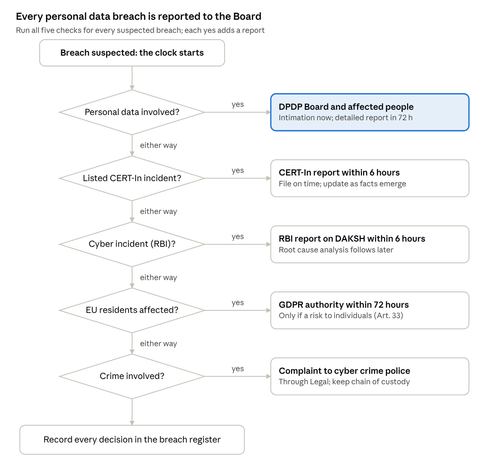

<h1 align="center">Personal Data Breach Response Playbook & Tabletop Kit</h1>

<p align="center">
  <b>A regulator-ready breach response programme for an Indian NBFC</b><br>
  DPDP Act 2023 · DPDP Rules 2025 · CERT-In Directions · RBI · NIST SP 800-61r3 · ISO/IEC 27001:2022
</p>

<p align="center">
  
  
  
  
  
</p>

---

## 📌 At a glance

| | |
| --- | --- |
| **What** | An end-to-end personal data breach response playbook plus a ready-to-run tabletop exercise |
| **For** | *Suvidha Finserv Ltd*, a fictional RBI-registered NBFC in Ahmedabad with ~12 lakh customers |
| **Why it is hard** | One breach starts **three regulatory clocks at once**: CERT-In (6 h), RBI (6 h) and the Data Protection Board (72 h) |
| **What it shows** | Privacy law, incident response, regulatory reporting, GRC control design and exercise facilitation |
| **Read it** | 👉 [**PLAYBOOK.md**](PLAYBOOK.md) |

---

## 🎯 The problem

Indian financial companies now face overlapping breach obligations:

- **DPDP Rule 7** requires **every** personal data breach to be reported to the Data Protection Board **and** to each affected person. Unlike GDPR, there is **no risk threshold**.
- **CERT-In Directions (2022)** require cyber incidents to be reported within **6 hours** of noticing them, with **180 days** of logs kept in India.
- **RBI** requires regulated entities to report cyber incidents within **6 hours**.
- **DPDP penalties** reach **₹250 crore** for weak security safeguards and **₹200 crore** for failing to notify.

Most organisations have a generic IT incident response plan. Very few have one that coordinates **privacy, cyber and financial-sector reporting in parallel**, with clear owners and pre-approved notices. This playbook fills that gap.

---

## 🧭 Reportability decision tree

Five checks run in the first hour of every suspected breach. Each "yes" adds a reporting obligation.

<p align="center">
  
</p>

---

## 🧩 What's inside

| # | Section | What it delivers |
| --- | --- | --- |
| 1 | Purpose, scope & document control | Ownership, approval, review cycle, related policies |
| 2 | Company profile | Data inventory by category and system, list of processors |
| 3 | **Regulatory timeline matrix** | CERT-In, RBI, DPDP Board, individuals, police, GDPR side by side |
| 4 | **Breach Response Team & RACI** | 8 roles and a RACI for 10 critical decisions |
| 5 | **Severity matrix** | 4 levels based on customer and business harm, plus escalation factors |
| 6 | **Hour-by-hour workflow** | From T+0 to T+30 days, with an owner for every step |
| 7 | Reportability decision tree | The diagram above |
| 8 | **Notification templates** | CERT-In report, Board intimation, 72-hour report, customer notice |
| 9 | Evidence & breach register | Chain of custody rules and a worked register entry |
| 10 | **Tabletop exercise kit** | Scenario, 8 timed injects, facilitator guide, scoring sheet |
| 11 | Post-incident review & KPIs | Review agenda and 10 board-level metrics |
| 12 | **Control mapping** | Each section mapped to DPDP, ISO 27001:2022 and NIST CSF 2.0 |
| 13 | Assumptions & disclaimer | What is illustrative and what to verify |

---

## ⏱️ The three clocks, side by side

| Regulator | Trigger | Deadline |
| --- | --- | --- |
| **CERT-In** | Listed cyber incident (data breach, leak, ransomware, unauthorised access…) | **6 hours** |
| **RBI** | Cyber incident at the NBFC | **6 hours** (DAKSH portal) |
| **Data Protection Board** | Any personal data breach | Intimation **without delay**, detailed report within **72 hours** |
| **Affected individuals** | Any personal data breach | **Without delay**, in plain language |

> **Design principle:** *Awareness starts the clock, not confirmation.* File on time with what you know, then update.

---

## 🎲 Tabletop exercise: "The Open Bucket"

A 2-hour, discussion-based exercise for the leadership team.

> **Thursday, 10:00.** A security researcher emails Suvidha's grievance inbox. He has found a public cloud storage link holding thousands of Aadhaar and PAN card scans with "suvidha" in the path…

Over **8 timed injects**, the team must:
- decide when the clock started and who owns the response,
- contain an exposure that sits in a **vendor's** environment,
- classify severity once logs show downloads from unknown IPs,
- handle a **journalist's** enquiry,
- file **CERT-In and RBI** reports inside 6 hours,
- respond to customers receiving **fraud calls** that quote their PAN,
- complete the **72-hour Board report**.

A **scoring sheet** rates 9 capabilities from 1 to 5, and low scores become tracked corrective actions.

---

## 🗺️ Framework alignment

| Framework | How it is used |
| --- | --- |
| **DPDP Act 2023 & Rules 2025** | Sec 8 Data Fiduciary duties, Rule 6 safeguards, Rule 7 breach intimation |
| **CERT-In Directions (Apr 2022)** | 6-hour reporting, 180-day log retention, NTP sync, point of contact |
| **RBI cyber incident reporting** | 6-hour reporting for NBFCs, root cause follow-up |
| **NIST SP 800-61 Rev. 3 / CSF 2.0** | Incident response lifecycle aligned to Govern, Detect, Respond, Recover |
| **ISO/IEC 27001:2022** | A.5.24–A.5.28 incident management, A.5.19–A.5.21 suppliers, A.8.15 logging, A.5.34 PII |
| **GDPR Art. 33–34** | Applied only where EU residents' data is affected |

---

## 🛠️ Skills demonstrated

- **Data privacy:** breach assessment, Data Fiduciary vs Processor obligations, notification content
- **Regulatory reporting:** parallel CERT-In / RBI / DPDP timelines, penalty exposure
- **Incident response:** containment, evidence preservation, chain of custody, recovery
- **GRC:** RACI design, severity classification, KPI and board reporting, control mapping
- **Third-party risk:** processor breach clauses (2-hour notice) and vendor coordination
- **Exercise design:** scenario writing, injects, facilitation and capability scoring

---

## 📂 Repository structure

```
dpdp-breach-response-playbook/
├── README.md                              ← you are here
├── PLAYBOOK.md                            ← full playbook and tabletop kit
└── images/
    └── reportability-decision-tree.png
```

---

## ⚠️ Disclaimer

*Suvidha Finserv Ltd* and every person, number and incident in this project are **fictional**. This is a portfolio project for learning and demonstration, **not legal advice**. Regulatory requirements reflect public sources as of **November 2026**. DPDP Rules commence in phases, so commencement dates should be checked before real-world use.

---

## 👩‍💻 About the author

**Khooshi Joshi**
